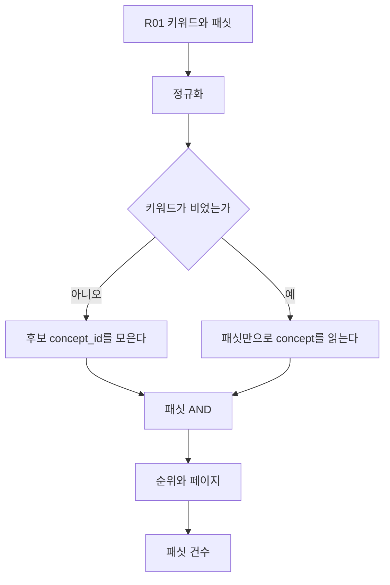

# 표준용어 검색 화면설계

> 문서 번호: 화면설계-SRC0010  
> 문서 버전: 0.1  
> 작성 기준일: 2026-11-15  
> 비밀구분: 대외비  
> 상태: 진행중  
> 근거: Athena Search (`/search-terms/terms`), `설계/프로세스설계/진행중/07_기타_프로세스설계-v0.1.md`, `platform/db/init/02_vocab.sql`  
> 프로그램: `SRC0010`  
> 읽는 데이터: `vocab` 현재본. 버전 스키마 `vocab_YYYYMMDD`는 검색하지 않는다.

검색은 현재본을 바꾸지 않는다. 이 화면에서 행을 고쳐 저장하지 않는다.

---

## 1. 화면이 맡는 일

Athena 검색과 같은 두 화면이다.

| 화면 | 하는 일 |
| --- | --- |
| 목록 | 키워드와 다섯 패싯으로 컨셉을 찾고, 코드·이름·클래스·표준 여부·유효·도메인·vocabulary를 표로 본다 |
| 상세 | 이름 클릭 후 속성, 동의어, 관계(Maps to 포함)를 본다 |

임시컨셉은 별도 메뉴가 아니다. `vocab.concept.is_local = true` 인 행은 이름 앞에 `임시`를 붙인다.

---

## 2. 이름

| 항목 | 값 |
| --- | --- |
| 업무 | 기타 · 표준용어 검색 |
| 프로그램 ID | `SRC0010` |
| 화면 파일 | `src/containers/trm/SRC0010/index.js` |
| 메뉴 URL | `containers/trm/SRC0010` |
| 목록 조회 | `SRC0010R01` · `POST /api/term/search/concepts/r01` |
| 상세 조회 | `SRC0010R02` · `POST /api/term/search/concepts/r02` |
| 요청 DTO | 목록 `SRC0010001Dto`, 상세 `SRC0010003Dto` |
| 응답 DTO | 목록 `SRC0010002Dto`, 상세 `SRC0010004Dto` |
| 패키지 | `buttle.apptpl.term.search` |

조회 Service는 `@Transactional(readOnly = true)` 이다.

---

## 3. 목록 화면

Athena와 같은 배치다. 위는 키워드, 왼쪽은 패싯, 가운데는 결과 표다.

```text
표준용어 검색                                          현재본 v20250827

키워드  [ aspirin________________________________ ]  [검색]  [?]

DOMAIN            결과 내려받기          15건 ▼     1  2  3  …     총 1,204건
 ▾ Drug  840
   Condition  12     ID      CODE     NAME            CLASS   CONCEPT   VALIDITY  DOMAIN  VOCAB
CONCEPT            1112807  1191     aspirin         Ingredient Standard Valid    Drug    RxNorm
 ▾ Standard  900     …        …        …               …       …         …         …       …
   Non-standard 304
CLASS
 ▾ Ingredient  610
VOCAB
 ▾ RxNorm  700
   SNOMED  420
VALIDITY
 ▾ Valid  1,100
   Invalid  104

[필터 지우기]
```

이름 셀만 상세로 이동한다. 열 머리의 화살표는 그 열 오름·내림이다. 기본 정렬은 검색 순위, 같은 순위면 이름, 그다음 `concept_id` 다.

### 3.1 키워드

| 항목 | 규칙 |
| --- | --- |
| 라벨 | 키워드 |
| 빈 값 | 패싯만 적용하고 이름 순으로 첫 페이지를 연다 |
| 따옴표 | `"aspirin"` 처럼 전체를 감싸면 이름·동의어·코드의 완전 일치만 찾는다 |
| 구분자 | `/ \ \| ? ! , ; .` 는 항상 띄어쓰기로 바꾼다 |
| 단독 기호 | `+ - ( ) : ^ [ ] ~ * &` 가 한 토큰이면 버린다. 단어 안에 붙어 있으면 남긴다 |
| 여러 단어 | 모든 토큰이 이름 또는 동의어에 있는 행을 위에 둔다. 그게 없으면 일부 토큰·유사 철자를 아래에 둔다 |
| 숫자만 | `concept_id` 일치를 맨 위에 두고, 같은 숫자를 `concept_code` 로도 찾는다 |
| 도움말 | 위 다섯 줄을 `?` 에 그대로 보여 준다 |

대소문자는 구분하지 않는다. 앞뒤 공백은 버린다.

### 3.2 패싯

다섯 가지다. 선택한 값은 AND 다. 한 패싯 안에서 여러 값을 고르면 그 패싯만 OR 다. 건수는 다른 패싯과 키워드를 적용한 뒤의 수다. 자기 패싯에서 고른 값은 건수 계산에서 빼서, 고르지 않은 값이 목록에서 사라지지 않게 한다.

| 패싯 | 컬럼 | 화면 값 |
| --- | --- | --- |
| DOMAIN | `domain_id` | `vocab.domain` 의 이름. 코드가 마스터에 없으면 코드 그대로 |
| CONCEPT | `standard_concept` | `S` Standard, `C` Classification, 빈 값 Non-standard |
| CLASS | `concept_class_id` | 코드 그대로 |
| VOCAB | `vocabulary_id` | 코드 그대로 |
| VALIDITY | `invalid_reason` | 빈 값 Valid, 값이 있으면 Invalid |

`필터 지우기` 는 패싯만 비운다. 키워드는 남긴다.

### 3.3 결과 표

| 열 | 컬럼 | 표시 |
| --- | --- | --- |
| ID | `concept_id` | 숫자 |
| CODE | `concept_code` | 원문 |
| NAME | `concept_name` | 링크. `is_local` 이면 앞에 `임시` |
| CLASS | `concept_class_id` | 원문 |
| CONCEPT | `standard_concept` | Standard / Classification / Non-standard |
| VALIDITY | `invalid_reason` | Valid / Invalid |
| DOMAIN | `domain_id` | 원문 |
| VOCAB | `vocabulary_id` | 원문 |

페이지 크기는 15, 30, 50, 100, 500. 기본 15.

`결과 내려받기` 는 같은 조건의 표를 파일로 받는다. 5만 건을 넘으면 받지 않고, 조건을 더 좁히라는 안내를 준다. 파일 생성은 조회이며 현재본을 바꾸지 않는다.

---

## 4. 상세 화면

목록에서 이름을 누르면 연다. 주소는 목록 쿼리를 유지한 채 이 컨셉만 연다. `뒤로` 는 목록의 키워드·패싯·페이지로 돌아간다.

```text
← 목록     aspirin

DETAILS                         TERM CONNECTIONS
Domain          Drug            RELATIONSHIP   RELATES TO              ID        VOCAB
Class           Ingredient      RxNorm ing of  Aspirin 325 MG Oral…   19019073  RxNorm
Vocabulary      RxNorm          …              …                       …         …
Concept ID      1112807
Concept code    1191            SYNONYMS
Validity        Valid           acetylsalicylic acid
Concept         Standard        ASA
Valid start     1970-01-01
Valid end       2099-12-31
임시컨셉        아니오
```

| 구역 | 내용 |
| --- | --- |
| DETAILS | `vocab.concept` 한 행. 날짜는 `2006-05-12` 형식 |
| SYNONYMS | `vocab.concept_synonym`. 없으면 구역을 비워 두지 않고 `동의어 없음` |
| TERM CONNECTIONS | 유효한 `concept_relationship`. 열은 관계, 상대 이름, 상대 ID, 상대 vocabulary |

관계의 상대 이름을 누르면 그 컨셉의 상세로 바뀐다.

---

## 5. 조회가 가는 순서

목록 한 번은 아래 순서다. 화면은 정규화하지 않고, 서버가 한다.



### 5.1 정규화

서버가 요청 문자열로 다음 세 값을 만든다.

| 값 | 예: `Type-2 diabetes` | 예: `"aspirin"` |
| --- | --- | --- |
| exact | false | true |
| phrase | `type-2 diabetes` | `aspirin` |
| tokens | `type-2`, `diabetes` | `aspirin` 하나 |

`-` 는 단어 사이에 붙어 있으면 공백으로 나누지 않는다. Athena에서 항상 나누는 기호는 `/ \ | ? ! , ; .` 뿐이다. `Type-2` 는 한 토큰 `type-2` 로 남는다. 숫자만인 토큰은 `concept_id` 후보에도 쓴다.

### 5.2 후보를 모으는 이유

`vocab.concept` 는 수백만 행이다. 한 장의 SQL에서 이름·동의어·유사도를 동시에 재면 trigram 인덱스를 타지 못한다. 그래서 인덱스가 있는 갈래만 먼저 읽고, `concept_id` 를 모은 다음 패싯을 건다.

갈래와 기본 순위:

| 순서 | 갈래 | 인덱스 | 순위 |
| ---: | --- | --- | --- |
| 1 | `concept_id` 일치 | PK | 1000 |
| 2 | `concept_code` 완전 일치 | `lower(concept_code)` | 900 |
| 3 | 이름 완전 일치 | trigram | 800 |
| 4 | 이름에 구문 전체가 포함 | trigram, `ILIKE` | 700 |
| 5 | 동의어 완전 일치 | synonym trigram | 650 |
| 6 | 동의어에 구문 전체가 포함 | synonym trigram | 600 |
| 7 | 이름 또는 동의어가 모든 토큰을 포함 | 토큰마다 trigram | 500 |
| 8 | 유사 철자 | `pg_trgm` `%` | similarity × 100 |

한 컨셉이 여러 갈래에 걸리면 가장 높은 순위만 남긴다.

완전 일치 모드(`exact = true`)는 1·2·3·5만 연다. 구문 포함과 유사 철자는 열지 않는다.

키워드가 비어 있으면 후보 갈래를 열지 않는다. 패싯이 걸린 `vocab.concept` 를 이름 순으로 자른다.

유사 철자(8)는 1~7의 후보가 20건 미만일 때만 연다. 열리면 유사도 상위 200개만 후보에 넣는다. 오타가 아닐 때 수백만 행을 유사도로 정렬하지 않기 위해서다.

### 5.3 패싯과 페이지

후보 `concept_id` 에 다섯 패싯을 AND 로 건다. 그 결과에서 순위, 이름, `concept_id` 순으로 `LIMIT/OFFSET` 한다.

패싯 건수는 같은 후보에 대해 패싯마다 한 번씩 `GROUP BY` 한다. DOMAIN 건수를 셀 때는 DOMAIN 조건을 빼는 식으로, 지금 보고 있는 패싯의 선택만 제외한다.

### 5.4 상세

`R02` 는 `concept_id` 하나로 세 쿼리를 읽는다. 목록 순위와 패싯은 다시 계산하지 않는다.

1. `vocab.concept`
2. `vocab.concept_synonym`
3. 유효한 `vocab.concept_relationship` 와 상대 `vocab.concept`

없는 ID는 404 다.

---

## 6. 쿼리

조건은 MyBatis `#{ }` 만 쓴다. 스키마는 `vocab` 를 명시한다.

아래 인덱스가 있어야 5.2의 갈래가 인덱스를 탄다. 이름·동의어 trigram 은 `02_vocab.sql` 에 이미 있다.

```sql
CREATE INDEX IF NOT EXISTS concept_code_lower_idx
    ON vocab.concept (lower(concept_code));

CREATE INDEX IF NOT EXISTS concept_name_sort_idx
    ON vocab.concept (concept_name, concept_id);

CREATE INDEX IF NOT EXISTS concept_domain_idx ON vocab.concept (domain_id);
CREATE INDEX IF NOT EXISTS concept_vocab_idx ON vocab.concept (vocabulary_id);
CREATE INDEX IF NOT EXISTS concept_class_idx ON vocab.concept (concept_class_id);
```

### 6.1 후보

숫자 키워드일 때만 ID 갈래를 붙인다. `tokens` 는 정규화된 토큰 배열이다. 아래 토큰 갈래는 `type 2 diabetes` 처럼 토큰이 세 개일 때의 모양이다. 토큰 개수는 `foreach` 로 늘린다.

```sql
SELECT c.concept_id, 1000 AS rank, 'ID' AS via
FROM vocab.concept c
WHERE c.concept_id = #{conceptId}

UNION ALL

SELECT c.concept_id, 900, 'CODE'
FROM vocab.concept c
WHERE lower(c.concept_code) = #{phrase}

UNION ALL

SELECT c.concept_id,
       CASE WHEN lower(c.concept_name) = #{phrase} THEN 800 ELSE 700 END,
       'NAME'
FROM vocab.concept c
WHERE lower(c.concept_name) = #{phrase}
   OR (#{exact} = false AND c.concept_name ILIKE '%' || #{phrase} || '%')

UNION ALL

SELECT s.concept_id,
       CASE WHEN lower(s.concept_synonym_name) = #{phrase} THEN 650 ELSE 600 END,
       'SYNONYM'
FROM vocab.concept_synonym s
WHERE lower(s.concept_synonym_name) = #{phrase}
   OR (#{exact} = false AND s.concept_synonym_name ILIKE '%' || #{phrase} || '%')

UNION ALL

SELECT c.concept_id, 500, 'TOKENS'
FROM vocab.concept c
WHERE #{exact} = false
  AND c.concept_name ILIKE '%' || #{token0} || '%'
  AND c.concept_name ILIKE '%' || #{token1} || '%'
  AND c.concept_name ILIKE '%' || #{token2} || '%'

UNION ALL

SELECT s.concept_id, 500, 'TOKENS'
FROM vocab.concept_synonym s
WHERE #{exact} = false
  AND s.concept_synonym_name ILIKE '%' || #{token0} || '%'
  AND s.concept_synonym_name ILIKE '%' || #{token1} || '%'
  AND s.concept_synonym_name ILIKE '%' || #{token2} || '%';
```

1~6이 20건 미만일 때 덧붙이는 유사 철자:

```sql
SELECT c.concept_id,
       (similarity(c.concept_name, #{phrase}) * 100)::int AS rank,
       'FUZZY' AS via
FROM vocab.concept c
WHERE #{exact} = false
  AND c.concept_name % #{phrase}
ORDER BY similarity(c.concept_name, #{phrase}) DESC
LIMIT 200;
```

서비스는 위 결과를 `concept_id` 별로 `max(rank)` 만 남겨 임시 집합 `best` 로 둔다. 한 요청 안에서는 메모리나 트랜잭션 임시 테이블이면 된다. 현재본 테이블에 검색 결과를 쓰지 않는다.

### 6.2 목록 페이지

```sql
SELECT c.concept_id,
       c.concept_code,
       c.concept_name,
       c.concept_class_id,
       c.standard_concept,
       c.invalid_reason,
       c.domain_id,
       c.vocabulary_id,
       c.is_local,
       b.rank
FROM best b
JOIN vocab.concept c ON c.concept_id = b.concept_id
WHERE (#{domainIds, jdbcType=ARRAY} IS NULL OR c.domain_id = ANY(#{domainIds, jdbcType=ARRAY}))
  AND (#{vocabularyIds, jdbcType=ARRAY} IS NULL OR c.vocabulary_id = ANY(#{vocabularyIds, jdbcType=ARRAY}))
  AND (#{classIds, jdbcType=ARRAY} IS NULL OR c.concept_class_id = ANY(#{classIds, jdbcType=ARRAY}))
  AND (
        #{standardFlags, jdbcType=ARRAY} IS NULL
        OR COALESCE(c.standard_concept, '') = ANY(#{standardFlags, jdbcType=ARRAY})
      )
  AND (
        #{validity} IS NULL
        OR (#{validity} = 'VALID' AND c.invalid_reason IS NULL)
        OR (#{validity} = 'INVALID' AND c.invalid_reason IS NOT NULL)
      )
ORDER BY b.rank DESC, c.concept_name, c.concept_id
LIMIT #{limit}
OFFSET #{offset};
```

키워드가 없을 때는 `best` 없이 같은 WHERE 를 `vocab.concept` 에 직접 걸고 `ORDER BY c.concept_name, c.concept_id` 한다. Non-standard 패싯 값은 빈 문자열 `''` 로 보내고, SQL의 `COALESCE` 가 `standard_concept` 빈 값과 맞춘다.

총건수:

```sql
SELECT count(*)
FROM best b
JOIN vocab.concept c ON c.concept_id = b.concept_id
WHERE /* 6.2와 같은 패싯 조건 */;
```

### 6.3 패싯 건수

DOMAIN 예시다. CLASS, VOCAB 는 `GROUP BY` 컬럼만 바꾼다. 이 쿼리의 WHERE 에는 DOMAIN 조건을 넣지 않는다.

```sql
SELECT c.domain_id AS id, count(*) AS cnt
FROM best b
JOIN vocab.concept c ON c.concept_id = b.concept_id
WHERE (#{vocabularyIds, jdbcType=ARRAY} IS NULL OR c.vocabulary_id = ANY(#{vocabularyIds, jdbcType=ARRAY}))
  AND (#{classIds, jdbcType=ARRAY} IS NULL OR c.concept_class_id = ANY(#{classIds, jdbcType=ARRAY}))
  AND (
        #{standardFlags, jdbcType=ARRAY} IS NULL
        OR COALESCE(c.standard_concept, '') = ANY(#{standardFlags, jdbcType=ARRAY})
      )
  AND (
        #{validity} IS NULL
        OR (#{validity} = 'VALID' AND c.invalid_reason IS NULL)
        OR (#{validity} = 'INVALID' AND c.invalid_reason IS NOT NULL)
      )
GROUP BY c.domain_id
ORDER BY cnt DESC, id;
```

CONCEPT 패싯:

```sql
SELECT COALESCE(c.standard_concept, '') AS id, count(*) AS cnt
FROM best b
JOIN vocab.concept c ON c.concept_id = b.concept_id
WHERE /* DOMAIN, CLASS, VOCAB, VALIDITY. standard 조건은 빼다 */
GROUP BY COALESCE(c.standard_concept, '')
ORDER BY cnt DESC, id;
```

VALIDITY 패싯:

```sql
SELECT CASE WHEN c.invalid_reason IS NULL THEN 'VALID' ELSE 'INVALID' END AS id,
       count(*) AS cnt
FROM best b
JOIN vocab.concept c ON c.concept_id = b.concept_id
WHERE /* DOMAIN, CONCEPT, CLASS, VOCAB. validity 조건은 빼다 */
GROUP BY CASE WHEN c.invalid_reason IS NULL THEN 'VALID' ELSE 'INVALID' END
ORDER BY id;
```

### 6.4 상세

```sql
SELECT c.concept_id,
       c.concept_name,
       c.domain_id,
       c.vocabulary_id,
       c.concept_class_id,
       c.standard_concept,
       c.concept_code,
       c.valid_start_date,
       c.valid_end_date,
       c.invalid_reason,
       c.is_local
FROM vocab.concept c
WHERE c.concept_id = #{conceptId};
```

```sql
SELECT s.concept_synonym_name,
       s.language_concept_id
FROM vocab.concept_synonym s
WHERE s.concept_id = #{conceptId}
ORDER BY s.concept_synonym_name;
```

```sql
SELECT r.relationship_id,
       c2.concept_id   AS target_concept_id,
       c2.concept_name AS target_concept_name,
       c2.concept_code AS target_concept_code,
       c2.vocabulary_id AS target_vocabulary_id
FROM vocab.concept_relationship r
JOIN vocab.concept c2 ON c2.concept_id = r.concept_id_2
WHERE r.concept_id_1 = #{conceptId}
  AND r.invalid_reason IS NULL
ORDER BY r.relationship_id, c2.concept_name, c2.concept_id;
```

`Maps to` 는 별도 쿼리가 아니다. `relationship_id = 'Maps to'` 인 연결이 위 결과에 같이 나온다.

---

## 7. 요청과 응답

### 7.1 R01 요청 `SRC0010001Dto`

| 필드 | 예 | 비움 |
| --- | --- | --- |
| keyword | `aspirin` | 패싯만 조회 |
| domainIds | `Drug`, `Condition` | 제한 없음 |
| standardFlags | `S`, `C`, `''` | 제한 없음 |
| classIds | `Ingredient` | 제한 없음 |
| vocabularyIds | `RxNorm` | 제한 없음 |
| validity | `VALID` 또는 `INVALID` | 제한 없음 |
| page | 1 | 1 |
| size | 15 | 15. 허용 15·30·50·100·500 |
| sort | `rank` | `rank`. 열 정렬이면 `concept_name` 등 |

### 7.2 R01 응답 `SRC0010002Dto`

| 필드 | 내용 |
| --- | --- |
| versionLabel | `vocab.vocabulary_version` 에서 `status = 'ACTIVE'` 인 라벨 |
| total | 패싯까지 적용한 건수 |
| items | 3.3의 여덟 열과 `is_local`, `rank` |
| facets | domain, standard, class, vocabulary, validity 각각의 `id`, `cnt` |

현재본이 없으면 200에 빈 목록과 총 0을 준다. 검색 실패로 보지 않는다.

### 7.3 R02

요청은 `conceptId` 하나다. 응답은 DETAILS 필드, `synonyms[]`, `connections[]` 다.

---

## 8. 화면에서 막 확인하는 것

| 입력 | 기대 |
| --- | --- |
| 빈 키워드 | 현재본 이름 순 첫 페이지. 패싯 건수 합이 총건수와 맞다 |
| `1112807` | 그 ID가 1행째. 같은 코드를 가진 다른 컨셉이 아래에 올 수 있다 |
| `aspirin` | 코드·이름 완전 일치가 구문 포함보다 위다. 동의어만 맞은 행도 나온다 |
| `"aspirin"` | 완전 일치만. 유사 철자 행이 없다 |
| `asprin` | 1~6이 적으면 `aspirin` 유사 행이 하단에 나온다 |
| DOMAIN = Drug, CONCEPT = Standard | 두 조건을 모두 만족하는 행만 |
| 없는 ID로 상세 | 404 |
| 임시컨셉 | 이름 앞 `임시`. 상세의 임시컨셉은 `예` |
